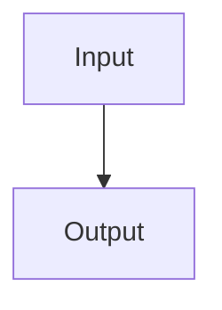

# Paper Title

> Verification status: draft

## 1. Overview

### Basic information

| Field | Value | Evidence |
| --- | --- | --- |
| Original title | Pending | [^paper-title] |
| Translated title | Pending | [^paper-title] |
| Authors | Pending | [^paper-title] |
| Year | Pending | [^paper-title] |
| Venue | Pending | [^paper-title] |
| DOI | Pending | [^paper-title] |
| arXiv ID | Pending | [^paper-title] |
| Paper ID | Pending | [^paper-title] |
| Canonical URL | Pending | [^paper-title] |
| Legal PDF URL | Pending | [^paper-title] |
| Local PDF | [Target paper PDF](target-paper.pdf) | [^paper-title] |
| Version or type | Pending | [^paper-title] |
| Category ID | Not classified | [^paper-title] |
| Subcategory ID | Not classified | [^paper-title] |

### Fields

Pending.

### Reading guide

Pending.

## 2. Core Content

### One-sentence overview

1. Pending: one sentence stating the problem solved.
2. Pending: one sentence stating its distinctive difficulty and downstream use.
3. Pending: one sentence stating the contribution relative to similar work.

### Differences from related work

Pending.

## 3. Environment and Assumptions

Pending.

## 4. End-to-End Flow

### Overall inputs and outputs

Pending: concrete overall inputs and outputs, separating training and model use
when applicable; place this before the graph and module table.

### Module roles

| Module | Input | Output | Role and downstream effect | Everyday analogy |
| --- | --- | --- | --- | --- |
| Pending | Pending | Pending | Pending | Pending |

### Worked end-to-end example

Pending: use one concrete input and trace operations, intermediate outputs, and
final output through the modules. Give training and model use separate headings
and demonstrations when applicable. Show an iteration or branch when present.
Reuse the case in formula demonstrations where useful.

## 5. Module Details

### Core-equation coverage

| Original locator | Equation or result | Formula card | Included or supported omission reason |
| --- | --- | --- | --- |
| Pending | Pending | Pending | Pending |

### Module name

Pending.

#### Formula card: equation name or number

Pending.

| Symbol or important term | Plain meaning and role |
| --- | --- |
| Pending | Pending |

Pending: explain the calculation and its purpose using basic mathematics. Give
each new specialist concept a concrete analogy or small worked example. Reuse
earlier definitions briefly and retain the source locator.

Pending: demonstrate this formula with concrete inputs, intermediate operations,
and the result. Calculate a small numerical example or explicitly walk through
a set, condition, or theoretical case. Reuse prior values while showing this
formula's own operation and outcome.

## 6. Experiments and Results

### Benchmark or case study

Pending.

| Parameter or setting | Value | Role in the evaluation |
| --- | --- | --- |
| Pending | Pending | Pending |

Pending.

| Source-reported condition | Method | Source-reported metric ↑/↓ |
| --- | --- | ---: |
| Pending | Pending | Pending |

Pending.

## 7. Limitations and Future Work

Pending.

[^paper-title]: [Target paper PDF](target-paper.pdf#page=1), p. 1.
